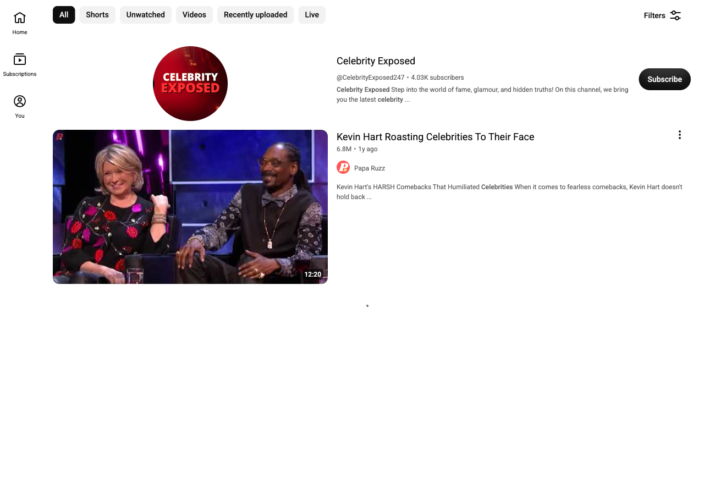
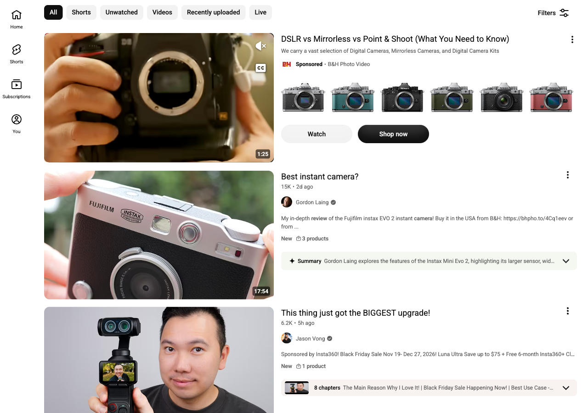
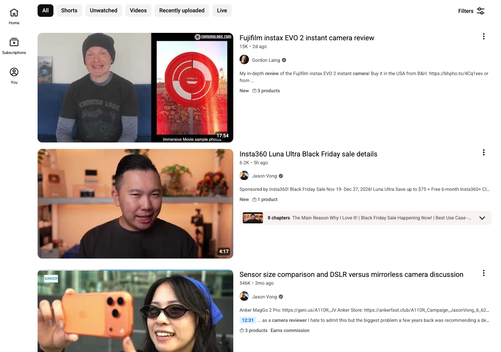
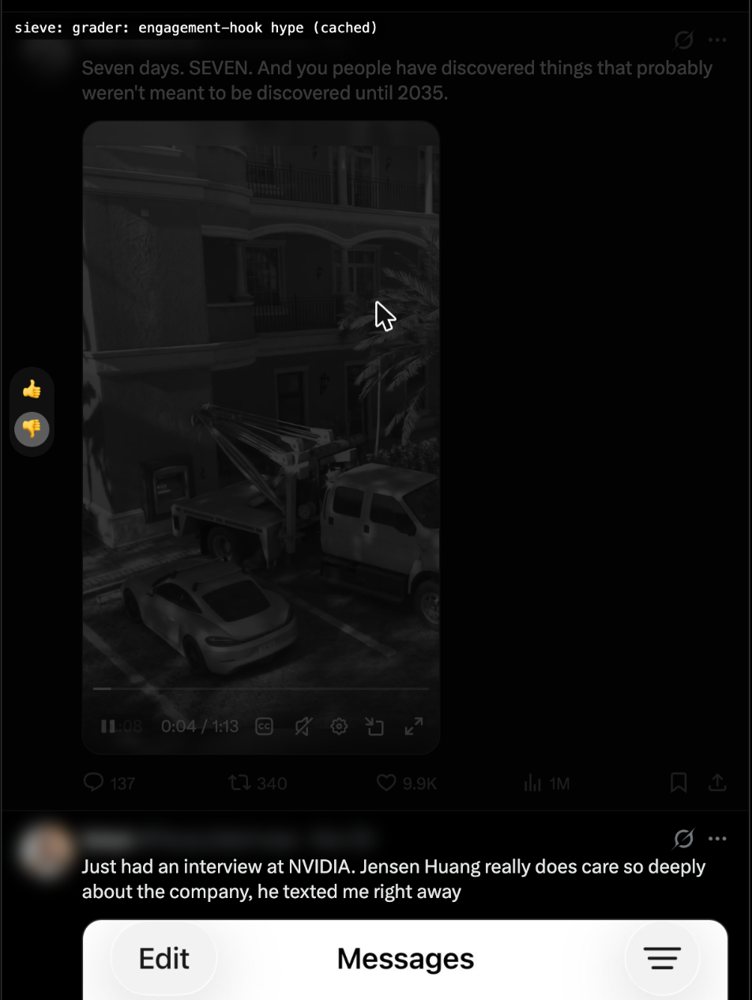
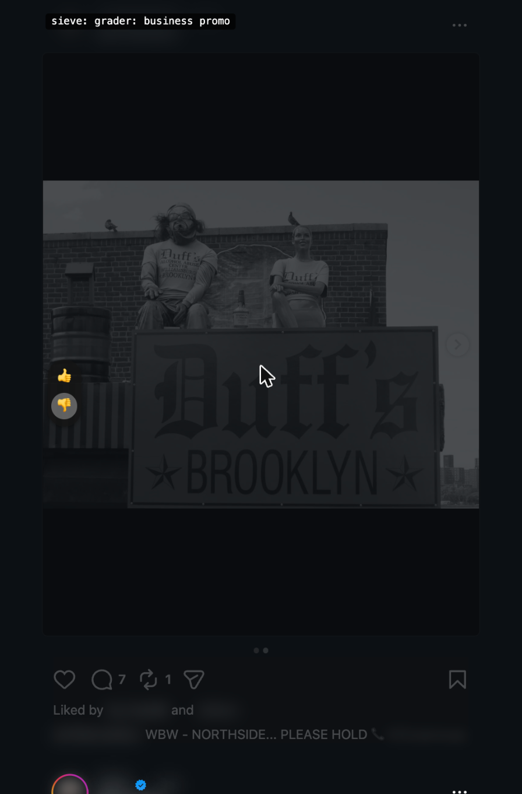

# Sieve for Chrome

Sieve sits between YouTube, X and Instagram and your eyes. It looks at every post as it arrives, decides whether it's worth your attention, and removes or greys out the ones that aren't. A small AI model on your own computer does the judging, against a written description of your taste, and it learns from every 👍 and 👎 you give it.

By Milind Anand, built with Claude Code. Based on Teddy Warner's original Firefox extension, [Twarner491/sieve](https://github.com/Twarner491/sieve) (MIT license): the idea and the core design are his. This version runs on Chrome and adds 👍 / 👎 feedback, creator learning, grading from the page, and plain titles.

## Before and after

Same YouTube search, "celebrity drama exposed", in a fresh browser with no account.

| Without Sieve | With Sieve: dimmed |
|---|---|
|  |  |

Or remove them completely: turn on **Hide dropped** in Settings.



Bait titles rewritten to say what the video is. Search: "camera review".

| Without Sieve | With Sieve |
|---|---|
|  |  |

X and Instagram, graded straight off the page (names and avatars blurred for this README):

<p>


</p>

---

## Features

- **Dim or remove.** Posts Sieve decides against stay in place, greyed out with a short reason, and you can still click them. Turn on **Hide dropped** and they disappear instead.
- **Always removed:** ads, sponsored and paid-partner posts, Shorts, YouTube mixes, "Suggested for you" posts, and upsell banners.
- **AI grader that judges your taste.** It runs free on your Mac through Ollama, or on Claude, OpenAI or Gemini with your own API key.
- **About you.** Describe yourself in Settings, and the grader reads that first.
- **👍 / 👎 on every card.** Each click is permanent, beats every rule, and teaches the grader. The right-click menu adds "always keep" and "always dim" for a creator.
- **Plain titles.** Bait YouTube titles are swapped for ones that say what the video covers, from DeArrow's community or written from the creator's own description. Hover a title to see the original.
- **Calmer feeds.** Fewer ALL CAPS and "!!!" in titles, and thumbnails show a frame from the middle of the video.
- **Curated keep lists.** Hacker News favourites, Kagi's small channels, and channels of photographers, filmmakers, animators and artists.
- **AI-slop list.** About 71,000 channels that post AI-generated junk are dimmed.
- **Bait catchers.** "Comment X for the guide", stories cut off mid-sentence, ragebait reply ratios on X, and repeats of stories you already read.
- **Cleaner sites.** YouTube's Gemini and "Ask" buttons, X's sidebar clutter and Instagram's side rail are hidden. X gets the old bird logo back.
- **Per-site switches and a log.** Switch each part on or off per site from the toolbar popup, and see what was filtered and why.
- **Private by default.** Your corrections and the free grader stay on your computer.

---

## How it works

### 1. Seeing the posts

A site loads its feed as a block of raw data (a list of videos with titles and channels), then draws it on screen. Sieve gets at the posts two ways:

- **Before the page draws them.** On YouTube, Sieve catches the feed data on its way in, judges every item, and hands the page an edited copy.
- **After the page draws them.** X and Instagram now load most of their feed in ways an extension can't catch, so Sieve reads each tweet or post off the page and marks the ones it decides against.

### 2. Deciding, post by post

Each post goes down a checklist, and the first rule with an answer wins:

1. Your own 👍 or 👎 on that post. Final.
2. Ads and sponsored posts. Always out.
3. Creators you set to always keep or always dim.
4. Curated channels, kept: videos and channels shared on Hacker News (Andrej Karpathy's [HackerTube](https://hackertube.org)), small hand-picked channels from [Kagi Small Web](https://github.com/kagisearch/smallweb), and about 3,300 channels of photographers, filmmakers, animators, painters, sculptors, designers and architects listed on [Wikidata](https://www.wikidata.org).
5. About 71,000 channels on a public list of AI-generated junk ([AiSList](https://github.com/Override92/AiSList)). Dimmed. About 1,400 more that only partly use AI are not dimmed; the grader is told.
6. Wording that gives bait away: "comment X and I'll DM you the link", crypto casino codes, short-drama episodes, siren-emoji fake breaking news, gossip.
7. On X and Instagram, the rhythm of engagement farming. On X, a repeat of a story you already read is dimmed as "seen before".
8. A verdict the grader already gave this exact post.
9. Creators Sieve has learned from you: two keeps or three dims teach it.
10. On X, far more replies than likes, which usually means a fight in the replies.
11. Anything still undecided goes to the grader.

### 3. The grader

The grader is a small AI model (qwen3.5:4b) running on your Mac through Ollama, the app that runs AI models locally. Posts go to it in batches of up to 20, each as its text, its creator, and a note if you follow the account. With every batch it gets your taste description and the 30 past corrections of yours that look most like the posts in front of it. For YouTube videos it also checks the dislike share from [Return YouTube Dislike](https://returnyoutubedislike.com) and mentions it when a fifth or more of the votes are dislikes. It answers keep, unsure or drop for each post, with a 2 to 4 word reason for every drop, like "viral shock clips". Unsure means keep. It gets 6 seconds; anything slower is left alone. Verdicts are saved, so no post is judged twice.

### 4. What you see

Ads, Shorts, YouTube mixes, "Suggested for you" posts and upsell banners (NFL Sunday Ticket, for one) are removed. Everything else Sieve decides against stays in place, greyed out, with a small `sieve: <reason>` label, and you can still click it. Turn on **Hide dropped** in Settings if you'd rather they vanish. The rules act at once and the grader takes a second or two, so a post can appear normally and go grey a moment later.

### 5. Teaching it

Hover any card and 👍 / 👎 appear on its left edge. Or right-click the card and open the **Sieve** menu, which also has "always keep / always dim this creator". A click fixes that post right away, is saved permanently, beats every rule, and joins the examples the grader sees, so similar posts get judged your way next time. Sieve keeps your last 500 corrections. The button shows ✓ when a click is saved and ! when it isn't.

### 6. Smaller cleanups

Shouty titles are calmed (less ALL CAPS, fewer "!!!"). Bait YouTube titles ("What Happened to L.L. Bean?", "I tested...", titles ending in a question) are swapped for ones that say what the video covers. Sieve first uses a title written by the [DeArrow](https://dearrow.ajay.app/) community; if there is none, it reads the creator's description and has the grader write one, such as "Reviewing L.L. Bean products like bean boots, field coats, and wool sweaters". Hover a swapped title to see the original. Thumbnails show a frame from the middle of the video instead of the designed one. X gets the old bird logo back and a quieter sidebar.

### 7. What leaves your computer

Almost nothing. The grader runs on your Mac, and your corrections and verdicts stay in Chrome. DeArrow title lookups and Return YouTube Dislike send video IDs to those projects' servers, and plain titles load the video's YouTube page without your sign-in. If you switch the grader to **api** mode in Settings, post text goes to the AI service you set up there.

### 8. Limits

The model is small. It's fast enough for a live feed and still makes taste mistakes, which is what 👍 / 👎 are for. Sites change their insides often, and a change on X is what once stopped Sieve from grading X at all. Profiles and single-post pages are never filtered, only feeds.

---

## Why a Chrome version

Firefox lets an extension rewrite a site's feed data inside the browser's network layer, before the page ever sees it. Teddy's version is built on that. Chrome's current extension system (Manifest V3) took that ability away, so this version wraps the page's own data requests instead and passes each feed response to Sieve's background script for judging. Ollama also refuses requests from Chrome extensions by default, so Sieve strips the header that triggers the refusal. Everything else, from the checklist to the grader, is Teddy's design, extended here with 👍 / 👎 feedback, creator learning and grading from the page.

---

## 1. Clone

```bash
git clone --recurse-submodules https://github.com/milindanand13/sieve-for-chrome.git ~/sieve
cd ~/sieve
```

The default branch is `main`.

## 2. Load in Chrome

Open `chrome://extensions`, turn on **Developer mode**, click **Load unpacked**, and select `~/sieve/extension`.

## 3. Install the local grader (optional)

The rules, lists, DeArrow titles and cleanups work with no model installed. To turn on the grader:

```bash
brew install ollama
ollama pull qwen3.5:4b
ollama serve
```

You don't need to set `OLLAMA_ORIGINS`. Or switch **mode** to `api` in **Settings** to use any OpenAI-compatible chat completions endpoint.

The local grader is the default: it's free and nothing leaves your computer. For a little more accuracy, set **mode** to **claude haiku** in **Settings** and paste an [Anthropic API key](https://console.anthropic.com/). On 200 real feed posts, Claude Haiku graded 94% right against 89% for the local model, and caught about 3 times as many of the posts worth dimming (18 of 23 against 6). It costs about $1 a month at 1,000 posts a day.

## 4. Build from source (optional)

Prebuilt bundles are in `extension/dist/`. If you change `src/` or refresh the seed lists:

```bash
npm install
npm run seeds
npm run build
npm test
```

To check the grader against real flagged posts (needs Ollama running):

```bash
SIEVE_LIVE=1 npx vitest run tests/taste-eval.test.ts
```

---

- [Fork this repository](https://github.com/milindanand13/sieve-for-chrome/fork)
- [Watch this repo](https://github.com/milindanand13/sieve-for-chrome/subscription)
- [Create issue](https://github.com/milindanand13/sieve-for-chrome/issues/new)
