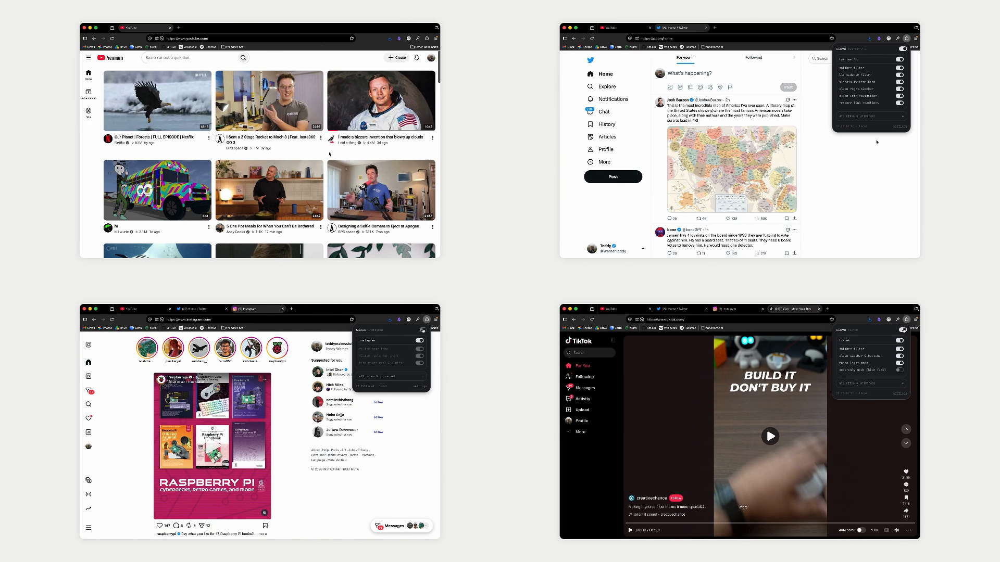

# Sieve

There is *sooo* much good content out there, and it's a shame most rec algorithms are built to one-shot you into a brain-dead state. Sieve filters your feeds so the good stuff is easier to find.

Original by Teddy Warner: [Twarner491/sieve](https://github.com/Twarner491/sieve). This fork ports it to Chrome.



Sieve filters YouTube, X, and Instagram. TikTok code is included but off by default.

---

## 1. Clone

```bash
git clone --recurse-submodules https://github.com/milindanand13/sieve.git ~/sieve
cd ~/sieve
```

The default branch is `main`.

---

## 2. Load in Chrome

Open `chrome://extensions`, turn on **Developer mode**, click **Load unpacked**, and select `~/sieve/extension`.

---

## 3. Build from Source (Optional)

Prebuilt bundles are in `extension/dist/`. If you change `src/` or refresh upstream seed lists:

```bash
npm install
npm run seeds
npm run build
npm test
```

---

## 4. Local LLM Grader (Optional)

Seed lists, ratio filters, DeArrow title lookups, and UI debloat work with no model installed. To enable local grading of items the rules cannot decide:

```bash
brew install ollama
ollama pull qwen3.5:4b
ollama serve
```

You do not need to set `OLLAMA_ORIGINS`. Sieve strips the Origin header itself.

Or switch **mode** to `api` in **Settings** to use any OpenAI-compatible chat completions endpoint.

---

## 5. Using It

- **Removed outright:** ads, Shorts, mixes, promoted items, and suggested items.
- **Dimmed:** low-quality items stay in place with a small `sieve: <reason>` label. You can still click them.
- **Hide dropped:** turn on this switch in **Settings** to remove dimmed items instead of dimming them.
- **Feedback:** right-click any feed card and open the **Sieve** menu:
  - Not slop, keep this
  - Slop, dim this
  - Always keep this creator
  - Always dim this creator
- Your corrections stick and beat every rule. The last 30 are shown to the grader as examples.
- **Popup:** shows counts per site and a drop log.

---

- [Fork this repository](https://github.com/milindanand13/sieve/fork)
- [Watch this repo](https://github.com/milindanand13/sieve/subscription)
- [Create issue](https://github.com/milindanand13/sieve/issues/new)
